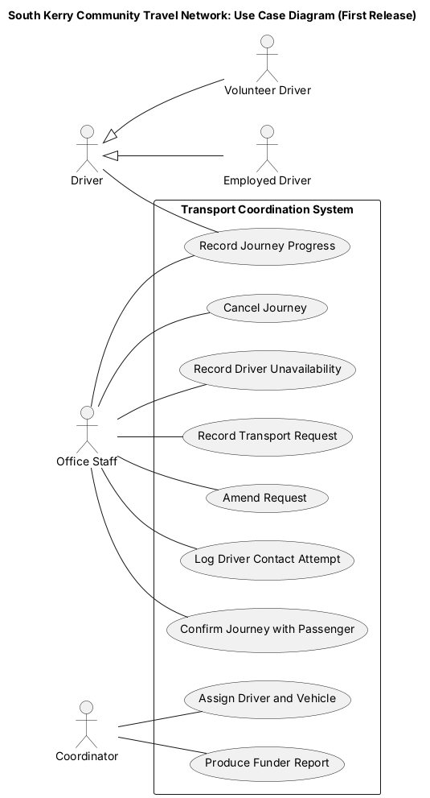

# Use Case Model

A use case describes how an actor uses the system to achieve a goal, together with what happens when things go wrong ([Cockburn, 2001](../references/01-text-sources.md#cockburn)). This model turns the functional requirements into the tasks people will carry out, at user-goal level: each is a task an actor completes in one session. The system boundary is the **Transport Coordination System**. Only primary actors appear on the diagram: passengers, referrers, funders and other offstage stakeholders are covered in the [stakeholder and actor catalogue](03-stakeholder-and-actor-catalogue.md). The use case with the richest scenario evidence, UC03, is described in detail, following [Cockburn (2001)](../references/01-text-sources.md#cockburn) and [Larman (2004)](../references/01-text-sources.md#larman).

## Use Case Diagram

Source: [use-case-diagram.puml](../diagrams/use-case-diagram.puml)

**Actors**

| Actor | Description |
|---|---|
| Office staff | Enter and amend requests, contact drivers, confirm journeys, record cancellations and driver unavailability, and record journey progress phoned in by drivers without a smartphone. |
| Coordinator | Assigns drivers and vehicles and produces funder reports. |
| Driver | Records journey progress. Specialised by *Volunteer driver* (own car) and *Employed driver* (accessible vehicle), who share this goal but differ in the rules applied to them, such as accessible-vehicle authorisation ([FR06](../requirements/01-functional-requirements.md#FR06)). |

## Use Case Catalogue

| ID | Use case | Primary actor | Description | Requirements |
|----|----------|---------------|-------------|--------------|
| UC01 | Record Transport Request | Office staff | Enter a request's mandatory details and practical travel needs. The request cannot be allocated until all mandatory details are complete. | [FR01](../requirements/01-functional-requirements.md#FR01), [FR02](../requirements/01-functional-requirements.md#FR02), [FR04](../requirements/01-functional-requirements.md#FR04) |
| UC02 | Amend Request | Office staff | Change a request when an appointment or need changes, with each change recorded. Remove clinical information a referrer included. | [FR03](../requirements/01-functional-requirements.md#FR03), [FR14](../requirements/01-functional-requirements.md#FR14) |
| [UC03](#UC03) | Assign Driver and Vehicle | Coordinator | Assign a suitable driver and vehicle to the outward and return stages of a journey. *Detailed below.* | [FR05](../requirements/01-functional-requirements.md#FR05), [FR06](../requirements/01-functional-requirements.md#FR06), [FR08](../requirements/01-functional-requirements.md#FR08) |
| UC04 | Log Driver Contact Attempt | Office staff | Record the date, time and outcome of each call to a driver about a journey. | [FR07](../requirements/01-functional-requirements.md#FR07) |
| UC05 | Confirm Journey with Passenger | Office staff | Produce a confirmation stating the collection window, the driver or service contact, whether the driver will wait or return later and any travel contribution. | [FR09](../requirements/01-functional-requirements.md#FR09) |
| UC06 | Record Journey Progress | Driver; office staff | Record collection, arrival and return completion for each stage, including when there is no mobile signal. Office staff record progress for drivers without a smartphone who phone it in ([A08](05-assumptions.md#A08)). | [FR10](../requirements/01-functional-requirements.md#FR10), [NFR03](../requirements/02-non-functional-requirements.md#NFR03) |
| UC07 | Cancel Journey | Office staff | Cancel a journey or one stage, recording who cancelled, the reason, the notice given and whether the healthcare provider caused it. | [FR11](../requirements/01-functional-requirements.md#FR11) |
| UC08 | Record Driver Unavailability | Office staff | Record a period when a driver is unavailable and list the journeys affected, for reassignment through UC03. | [FR12](../requirements/01-functional-requirements.md#FR12) |
| UC09 | Produce Funder Report | Coordinator | Produce anonymised totals for a chosen date range. | [FR13](../requirements/01-functional-requirements.md#FR13) |

## Detailed Use Case

### UC03: Assign Driver and Vehicle

| | |
|---|---|
| **Primary actor** | Coordinator |
| **Supporting roles** | Office staff (contact drivers, [UC04](#UC04)) |
| **Stakeholders and interests** | *Passenger:* a vehicle that meets their needs and a clear return arrangement. *Driver:* sees only journeys they have accepted ([NFR01](../requirements/02-non-functional-requirements.md#NFR01)) and is free to decline ([BR08](06-rules-and-uncertainty-register.md#BR08)). *Employed driver:* wheelchair and companion needs known before the vehicle is assigned ([BR05](06-rules-and-uncertainty-register.md#BR05)). |
| **Preconditions** | The request has all mandatory details ([BR03](06-rules-and-uncertainty-register.md#BR03)). Driver and vehicle records exist. |
| **Trigger** | A request becomes ready for allocation. |

**Main success flow**

1. Coordinator selects a request that is ready for allocation.
2. System shows the request details and the passenger's practical travel needs.
3. Coordinator selects a driver and vehicle for the outward stage.
4. System checks that the vehicle meets the wheelchair and companion seating needs ([FR05](../requirements/01-functional-requirements.md#FR05)) and that the driver is authorised to drive it ([FR06](../requirements/01-functional-requirements.md#FR06)).
5. System saves the outward assignment within 3 seconds ([NFR02](../requirements/02-non-functional-requirements.md#NFR02)).
6. Coordinator repeats steps 3–5 for the return stage ([FR08](../requirements/01-functional-requirements.md#FR08)).
7. System shows the journey as assigned and ready for confirmation ([UC05](#UC05)).

**Alternative flows** (the goal is still achieved by a different route)

- **3a. Driver declines.** The chosen volunteer declines when contacted. Office staff log the attempt ([UC04](#UC04), [FR07](../requirements/01-functional-requirements.md#FR07)); coordinator returns to step 3 and selects another driver.
- **6a. Return time uncertain.** The finishing time is too uncertain to plan the return. The return stage is saved unassigned and shown as outstanding; coordinator completes it later ([A02](05-assumptions.md#A02), [Q04](04-stakeholder-questions.md#Q04)).
- **6b. Different return driver.** Another driver will complete the return. The return stage is assigned to that driver with its own status ([FR08](../requirements/01-functional-requirements.md#FR08), [A05](05-assumptions.md#A05)).

**Exceptions** (a check fails and the step is rejected)

- **1a. Request incomplete.** A mandatory detail is missing. System blocks allocation and names the missing field ([FR02](../requirements/01-functional-requirements.md#FR02)). Use case ends; office staff complete the request through [UC02](#UC02).
- **4a. Vehicle unsuitable.** The vehicle lacks the required wheelchair space or companion seats. System rejects the assignment and states why ([FR05](../requirements/01-functional-requirements.md#FR05)); coordinator returns to step 3.
- **4b. Driver not authorised.** The driver is not authorised for the accessible vehicle. System rejects the assignment ([FR06](../requirements/01-functional-requirements.md#FR06)); coordinator returns to step 3.
- **4c. No suitable driver or vehicle.** No available combination passes the checks. Coordinator leaves the request unallocated; the passenger and referrer must be told ([BR10](06-rules-and-uncertainty-register.md#BR10)). Recording that notification is deferred ([DFR15](../requirements/03-deferred-requirements.md#DFR15), [Q07](04-stakeholder-questions.md#Q07)).

**Postconditions**

- *On success:* the outward and return stages each have a driver and vehicle that passed the capacity and authorisation checks, and the journey is ready for confirmation.
- *On failure:* no stage holds an assignment that failed a check, and the request remains visible as unallocated.

**Open issues**

- Whether an unconfirmed assignment reserves the driver or vehicle is unresolved ([Q03](04-stakeholder-questions.md#Q03)), so preventing double-booking of accessible vehicles is deferred ([DFR07](../requirements/03-deferred-requirements.md#DFR07)).
